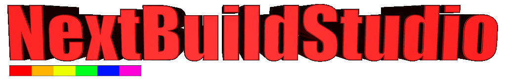

<style>
  .highlight {
    background-color: #222;
    color: #ffd700;
    padding: 4px 8px;
    border-radius: 4px;
  }
  .section {
    background-color: #1a1a1a;
    border-left: 4px solid #007acc;
    padding: 10px;
    margin-bottom: 12px;
  }
  .note {
    background: #2c2c2c;
    padding: 10px;
    border-left: 4px solid #66bb6a;
    margin-top: 10px;
  }
</style>

# 🎉 <span style="color:#4ec9b0;">Welcome To</span>
 

### <span class="highlight">v2025.10.10</span> &nbsp;&nbsp;🔗 [zxnext.uk/nextbuildstudio](https://zxnext.uk/nextbuildstudio)

---

Welcome to **NextBuild Studio (NBS)** — everything you need to make brilliant **ZX Spectrum Next** games and apps without going completely mad.

Built around the brilliant [**Boriel ZX Basic Compiler**](https://github.com/boriel-basic/zxbasic) by [boriel](https://zxbasic.readthedocs.io/en/docs/), NBS adds proper Next hardware support so you can actually use all the fancy new features:

Make sure you check out the `tutorials` on [**NextBuilds Home**](https://zxnext.uk/nextbuildstudio)

- 🕹️ Edit Sprites with `.spr`, `.til`, `.fnt` support  
- 🎵 Sampled sound, PT3 music, SFX playback  
- 🎨 Full 256-colour support, DMA & Copper effects  
- 💻 Proper integrated development with hover-help and inline docs  
- ⚡ One-click compile & run with CSpect  
- 🧠 Real-time syntax checks and auto-snippets

---

## 🛠️ How This All Works

NextBuild Studio is built with Codium, so if you've used Visual Studio Code before, you'll feel right at home! On the left you've got the `Explorer` view for navigating your `workspace` (basically just the folder with all your files in). When **NBS** starts up, it'll be looking at your `Documents\NextBuildv9\` folder. 

The tabs at the top show your open files. 


## ``Important!``
If you wander off and want to get back to this page, just **right-click** the `ReadMe.md` in the `Explorer` and choose **Open Preview**

When you open a `.bas` file, you can then use `F1` to open the inline help system.

---

## 🚀 Getting Started

In NBS, you edit `.bas` files and build them with the **Compile** button (bottom bar) or just press `F5`.

Give it a go:
- Click on [**holymoley.bas**](./NextBuild_Examples/GAMES/HoleyMoley/holeymoley.bas)  
- Then click **Compile**, press `F7 → Build Source` or `F5` to Complile & Run.
- It'll build and fire up CSpect automatically!

The **Explorer** will open the folder on the left. Have a poke around with the inline docs and hover-help — press **F1** for more details!

---

## 🛠️ Built-in Tools

- 🧱 **Sprite Editor** (`.spr`, `.til`, `.fnt`, `.nxm`)
- 🗺️ **Map Editor** (`.nxm`)
- 🖼️ **Image Importer** (sprites, panels, convert images)
- 🧩 **Block Editor** (composite sprite editing)
- 🔍 **Image Viewer** (`.nxi`, `.sl2`)
- 📘 **Inline Help** and ZX Basic Docs (F1)
- ✅ **Syntax Checker**, **Snippets**, and **Templates**
- 🔊 **PT3 Player** (Windows only) - Right-click a ```.pt3``` file in the explorer to play, ```Esc``` to quit
- 🎹 **AYFX editor** ``Ctrl+Shift+P``, type ``"AYFX"``
- 🚦More commands available in the **Command Palette** ```ctrl+shift+p``` and type ```NextBuild```

---

## 🧪 Must Reads 

Nextbuild Studio is *Feature* packed and there's a lot to learn, make sure you read
- [The CSpect Readme](../Emu/CSpect/ReadMe.txt) - Bursting at the seams with keyboard shortcuts and commands!
- [NextBuild Studio](./Docs/Settings.md) - Folder structure, how to change compiler versions  
- [Creating a New Project](./Docs/Templates.md) - Step by step template use
- [The Editors](./Docs/Editors.md) - Quick overview of the NextBuild Studio editors
- [Start Here](./Docs/Introduction.md) - Introduction to NextBuild Studio
---

## 📂 Quick Access

### 💻 Example Projects
- [📝 Hello World](./NextBuild_Examples/OTHER/HelloWorld/HelloWorld.bas)
- [🕹️ Sprite Demo](./NextBuild_Examples/GRAPHICS/Sprites/SimpleSprite.bas)
- [🕹️ Comprehensive Sprite Scale](./NextBuild_Examples/GRAPHICS/Sprites/ScaleRotataSprite.bas)

### ⚙️ Tasks & Commands
- [▶ Run Emulator](command:workbench.action.tasks.runTask?%5B%22Start%20Cspect%22%5D)
- [🛠️ Build File](command:workbench.action.tasks.build)
- [⚙ Open Settings](command:workbench.action.openSettings)

### 📚 Help & Documentation
- [🔤 Keyword Help](command:nextbuild-viewers.showKeywordHelp)
- [🧠 Z80 Tips](./docs/Z80Tips.md)
- [📦 Compiler Settings](./docs/CompilerSettings.md)
- [🌟 Credits & Contributions](./Docs/Contributions.md)

---

<div class="note">
💡 <strong>Top tip:</strong> You can click on any <code>.bas</code> file above to load it straight into the editor!
</div>

---

## 🙏 Credits

NextBuild Studio has been a proper labour of love, developed over many years by **David Saphier**. It absolutely wouldn't exist without these brilliant people:

- **boriel https://ko-fi.com/boriel**  
- **D Xalior Rimron-Soutter https://zx.xalior.com/**  
- **Mike "Flash" Ware https://www.rustypixels.uk/**  
- **Mike Dailly https://lemmings.info/**  
- **Peter Helcmanovsky https://ped7g.itch.io/**
- **Remy Sharp https://remysharp.com/**  
- **Jari Komppa https://solhsa.com/**
- **DuefectuCorp http://duefectucorp.com/**
- **Leslie Greenhalgh**
- **Richard Faulkner**

```Apologies if I've missed anyone — there have been loads of people who've helped over the years. Cheers to all of you!```

👉 **[See full credits and support links →](./Docs/Contributions.md)**

---

## 📝 Notices

- **NextBuild-Studio** and its components are © 2025 **David Saphier**, unless otherwise noted.  
- **Boriel Basic** is © José Rodríguez  
- **CSpect** is © Mike Dailly

---
